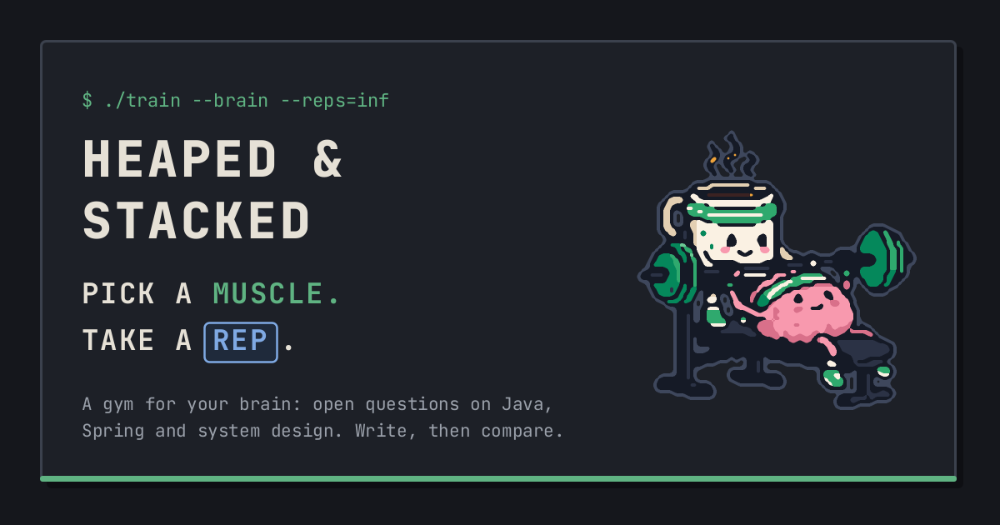

# Heaped & Stacked: web app

### Try the app at [heapedstacked.dev](https://heapedstacked.dev)

Heaped & Stacked is an online learning tool, generally focused on programming and specifically on
Java and Spring. The goal is to bring questions as plain and simple as possible, like you would get
them from a colleague or hear them in an interview. The expected format is free text with
self-evaluation, allowing one to track progress on certain topics and to compare how well an answer
stands next to their previous ones, or next to a sample one provided by the app.

It does not intend to be a teaching authority, but rather focuses on bringing users the right
questions and documentation references. It even asks users to do their own research and not to rely
on what they see here.

It does not intend to be a Codewars-style app. There are questions in the bank asking how code
snippets behave, but nothing that a user submits is compiled or executed on the server.

Lastly, the app leaves room to grow through use. Users may create custom topics with their own
questions, and even contribute to existing topics by adding new questions to the pool.

This repository is the web app, a React single-page app. The API is in
[heaped-and-stacked-service](https://github.com/heaped-and-stacked/heaped-and-stacked-service).



## The gym

The app speaks gym: topics are **muscles**, questions are **exercises**, and your answers are
**sets**. The bar under the menu picks the muscles for your next workout, on every page.

| Screen | What you do there |
| ------ | ----------------- |
| **Training rack** | Work through exercises one at a time. Write your set, submit it, then open the sample set and grade yourself. Your earlier sets on the same exercise show up beside it. Vote on the exercise, or leave a note for its coach. |
| **Past workouts** | Your sets on a calendar, your most trained muscles, and every exercise you've done, sorted by newest, weakest or longest ago. Open one to look back at all your sets on it. |
| **Coach's Corner** | Write exercises, and read the feedback on them. Muscle owners approve what others add to their muscles. |
| **Locker room** | Your display name, signing out, and deleting your account. |
| **Front desk** | For head coaches: the gym's numbers, roles, blocking and invites. |

Plus the usual pages in the footer: about, privacy, terms, code of conduct and contact.

## Who can do what

| You are | You can |
| ------- | ------- |
| **A visitor** | Pick muscles and train right away, without an account. Saving a set asks you to sign in with GitHub, and your draft survives the trip. |
| **A member** | Keep every set and see your progress; vote and leave notes; write exercises; open up to five muscles of your own. |
| **A muscle owner** | Decide whether others' exercises need your approval, then approve or decline them, and verify the exercises on your muscles. |
| **Gym staff** | Curate the gym's own muscles: verify, fix, bench and approve, and bring community muscles into the gym. |

**Reviewer mode** is how owners and staff curate. A switch in the top bar turns training into
checking: read the exercise, then verify it or fix it, and move on to the next. Off, the app looks
exactly as it does for any member.

Dark and light themes, a layout for phones, and keyboard use throughout.

## How it was built

The first version came from [Lovable](https://lovable.dev). Its free tier's limits and slow
responses soon got in the way, so everything was reimplemented with
[Claude Code](https://claude.com/claude-code), which improved both the speed of development and the
quality of the result.

Claude was closely involved throughout. [CLAUDE.md](CLAUDE.md) is the guide it works from: the
vocabulary, the structure and the design rules. It's also the most complete description of the
app's behaviour, for people too.

## Technology

| Technology | Where it fits |
| ---------- | ------------- |
| **React 19, TypeScript** | The whole app, with strict types. |
| **Vite** | Dev server and build. A plain single-page app: it's interactive from the first screen, so server rendering would add little. |
| **TanStack Router** | Routes defined in code, in one file. |
| **TanStack Query** | Server state: one hook per API call, so pages never call `fetch` themselves. |
| **openapi-fetch** | Typed server calls, with types generated from an OpenAPI spec, so a changed contract shows up as a compile error. |
| **Tailwind CSS 4** | Styling from colour tokens with a value per theme. No component library: the building blocks are small and live in one file. |
| **MSW** | A pretend API for mock mode, so the app runs with no backend. |
| **nginx, Docker** | Serves the built files, with a strict Content-Security-Policy. |

## Run it locally

You need Node.js 24 or newer. Mock mode runs the whole app against a pretend API, with sample data
and no backend or GitHub account:

```sh
npm install
npm run dev:mock
```

Then open http://localhost:5173. The [development guide](docs/development.md) covers running it
against the real backend.

## Documentation

Detailed documentation lives in [docs/](docs/README.md):

- [Architecture](docs/architecture.md): every page and its route, and how the app is put together
- [Design](docs/design.md): the look and feel, and the rules that keep it consistent
- [Development](docs/development.md): running, configuring and changing it

## Releases

Changes between versions are published on the
[Releases page](https://github.com/heaped-and-stacked/heaped-and-stacked-ui/releases).

## Found a bug?

Please [open an issue](https://github.com/heaped-and-stacked/heaped-and-stacked-ui/issues).

## Licence

© 2026 Haprean Manuel. All rights reserved. The code is public to read and learn from; it isn't
licensed for reuse.
